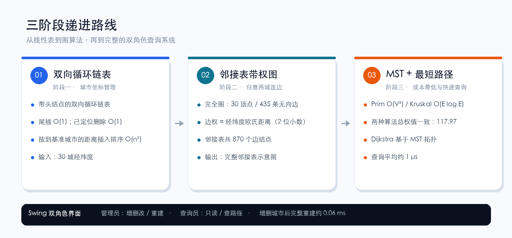
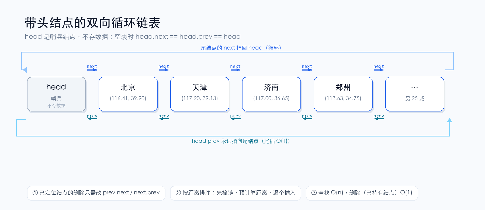
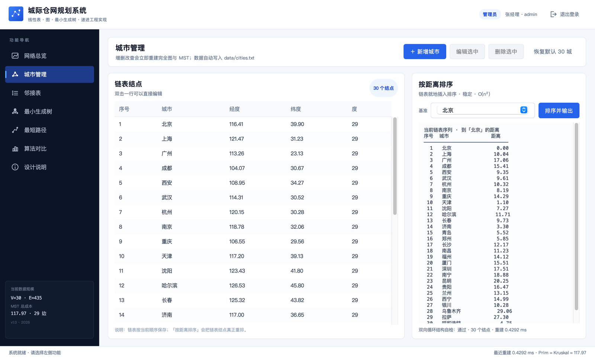
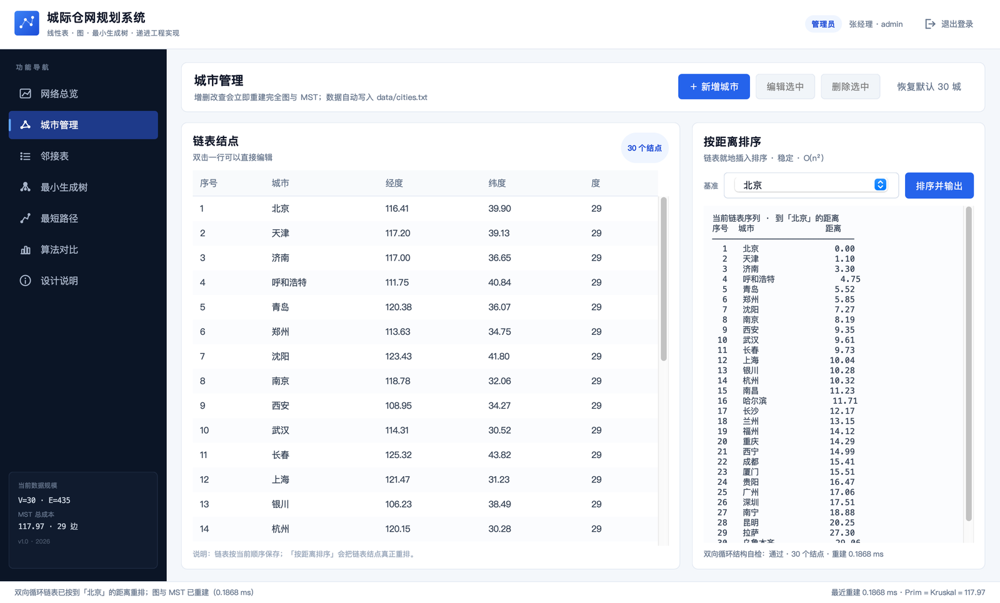
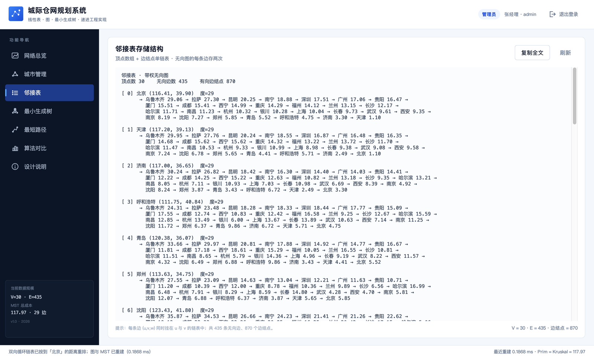
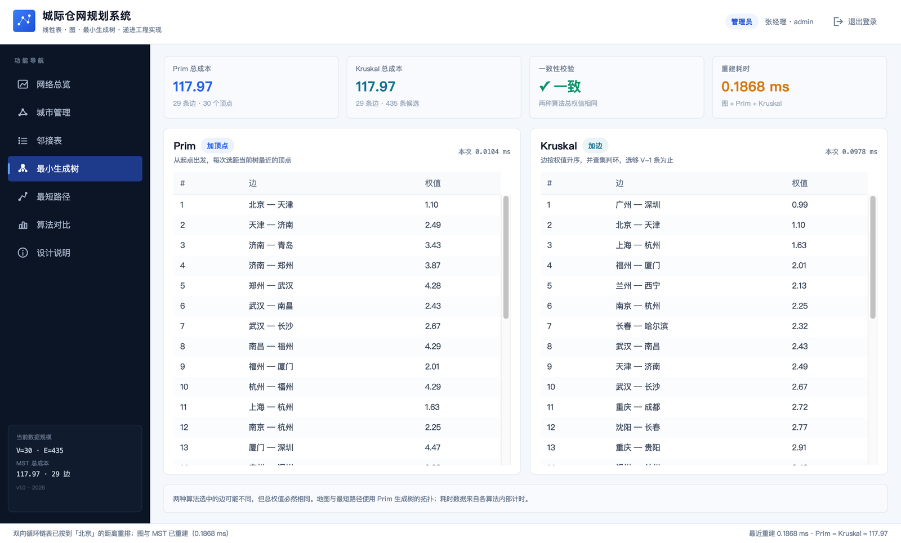
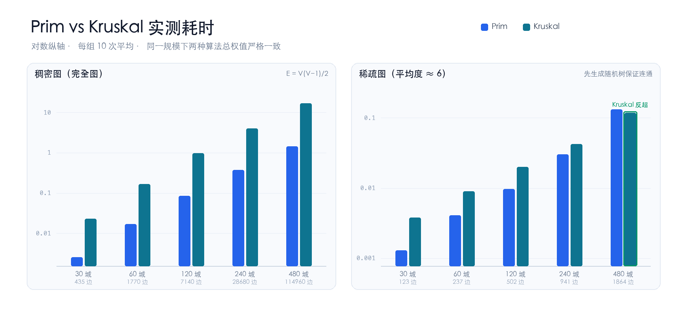
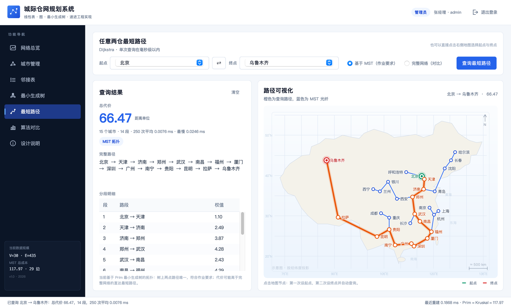
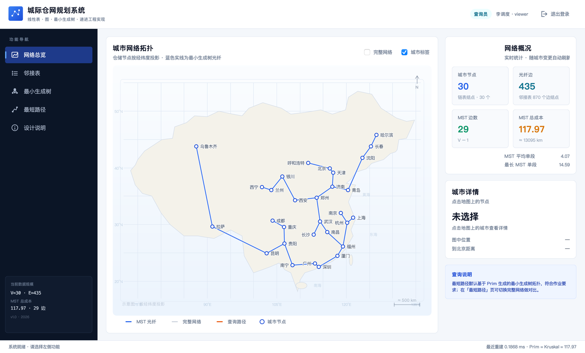
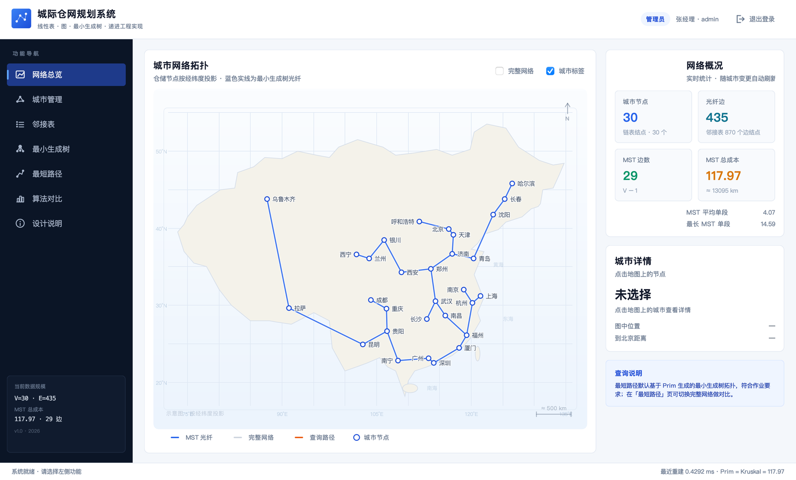

# “线性表 + 图 + 最小生成树”的递进工程实现

**——城际仓网规划系统实验报告**

## 摘要

本项目面向“30 个城市仓储节点之间铺设光纤专线”的物流场景：在保证全网连通的前提下让铺设总成本最低，并提供任意两仓之间的最短路径查询。系统严格按照课程要求分三个阶段递进实现：第一阶段用**带头结点的双向循环链表**管理城市坐标，支持增删改查和按距离排序；第二阶段以城市经纬度为顶点、以欧氏距离为边权，建立**邻接表存储的带权无向图**；第三阶段分别用 **Prim** 和 **Kruskal** 求最小生成树，再基于 Prim 生成树的拓扑用 **Dijkstra** 查询任意两城的最短路径。系统采用 Java 17+ 与 Swing 实现双角色桌面界面，管理员可以增删改城市、查询员只读查询；任何城市变更都会在约 0.06 ms 内完成“完全图 + 两棵 MST + 路径缓存”的完整重建。

**关键词**：双向循环链表；邻接表；最小生成树；Prim；Kruskal；Dijkstra；Swing

---

## 目录

1. 项目概述与总体设计
2. 第一阶段：双向循环链表管理城市
3. 第二阶段：邻接表存储带权无向图
4. 第三阶段（上）：Prim / Kruskal 最小生成树
5. 第三阶段（下）：Dijkstra 最短路径查询
6. 系统界面与双角色实现
7. 测试与性能实测
8. 问题解答（1.5 节四问）
9. 总结与改进方向
10. 附录：30 城数据、MST 边表、运行说明

---

## 一、项目概述与总体设计

### 1.1 场景与需求

某物流公司要在 30 个城市新建仓储节点之间铺设光纤专线。系统需要同时解决两个问题：

- **建网成本最低**：光纤必须把 30 个仓库全部连通，且总铺设成本最小——这正是一棵**最小生成树**；
- **日常配送查询**：任意两个仓库之间给出完整路径和总代价，并要求毫秒级响应——这是**最短路径**问题。

数据以 `cities.txt` 给出，每行是“城市名 经度 纬度”。任意两城之间的边权按题目定义为经纬度平面上的欧氏距离，保留 2 位小数：

```text
w(u, v) = round2( sqrt( (lon_u - lon_v)^2 + (lat_u - lat_v)^2 ) )
```

> 单位说明：按题目定义，边权单位是“度”。1 个纬度约相当于 111 km，界面上同时给出近似公里数（总成本 117.97 ≈ 13,095 km），但所有算法计算严格使用题目要求的“度”制欧氏距离，不做额外换算。

### 1.2 三阶段递进与需求映射

| 阶段 | 作业要求 | 本项目实现 |
|---|---|---|
| 一 | 双向循环链表录入 30 城坐标，增删改查、按距离排序，输出完整链表 | `CityList`：带头结点、双向循环；链表上就地插入排序；界面“城市管理”页实时输出序列 |
| 二 | 以欧氏距离为边权建带权无向图，邻接表存储，输出完整邻接表 | `Graph`：顶点数组 + 边结点单链表；30 顶点 / 435 无向边 / 870 个边结点；界面“邻接表”页全文展示 |
| 三 | Prim、Kruskal 分别求 MST，输出总权值与所有边；基于 MST 拓扑用 Dijkstra 查询任意两城 | `Prim`、`Kruskal`、`Dijkstra`；总权值 117.97；界面“最小生成树”“最短路径”页对照展示 |
| 系统 | 有系统界面，至少两种角色，增删城市后快速更新最短路径和 MST | Swing 桌面程序；管理员 / 查询员；新增或删除后同步重建图、MST 与路径缓存（约 0.06 ms） |

### 1.3 总体架构



*图 1　三阶段递进路线与系统层*

项目分为四层：

| 层次 | 主要类 | 职责 |
|---|---|---|
| 数据模型 | `City`、`Geo`、`CityList`、`Graph` | 城市对象、距离计算、双向循环链表、邻接表图 |
| 算法 | `Prim`、`Kruskal`、`Dijkstra`、`UnionFind`、`Benchmark` | 两棵 MST、最短路径、并查集、性能实测 |
| 应用服务 | `NetworkService`、`Auth`、`Role`、`SelfTest` | 状态中心、城市变更、重建、登录、命令行自检 |
| 界面 | `LoginFrame`、`MainFrame`、各功能 Panel、`MapPanel` | 双角色登录、导航、地图绘制、表格与图表 |

关键设计是 `NetworkService` 作为唯一状态中心：它持有双向循环链表、当前完全图、Prim/Kruskal 结果，以及一张**只含 MST 边**的图。任何城市变更都调用同一个 `rebuild()`，因此界面各页看到的数据始终一致。

### 1.4 技术选型

- **语言/运行时**：Java 17+（开发机为 JDK 24），只使用 JDK 标准库，无第三方依赖；
- **界面**：Swing，自绘圆角卡片、按钮、地图和图表，避免引入资源与网络依赖；
- **数据**：UTF-8 文本 `data/cities.txt`，修改城市后自动保存；
- **构建**：`javac --release 17` 编译，`jar` 打包，`运行系统.command` 双击启动。

---

## 二、第一阶段：双向循环链表

### 2.1 结构设计

链表结点保存 `City` 数据以及 `prev`、`next` 两个指针；链表额外带一个不存数据的**头结点 head**。所有结点首尾相接：



*图 2　带头结点的双向循环链表*

- 空表：`head.next == head.prev == head`；
- 第一个元素是 `head.next`，最后一个元素是 `head.prev`；
- 尾结点的 `next` 指回 head，head 的 `prev` 指向尾结点。

`CityList` 的核心字段与插入操作（摘自 `src/logistics/model/CityList.java`）：

```java
private static final class Node {
    City city;
    Node prev;
    Node next;
    double sortKey;          // 排序时缓存的距离
}

private final Node head = new Node(null);
private int size;

public void addLast(City city) {          // 尾插 O(1)
    Node node = new Node(city);
    Node tail = head.prev;                // 循环链表可直接取到尾结点
    node.prev = tail;
    node.next = head;
    tail.next = node;
    head.prev = node;
    size++;
}
```

### 2.2 增删改查与按距离排序

**删除**：先按名称查找 O(n)，拿到结点后摘链只需改两组指针。双链表的优势在于 `p.prev` 直接就是前驱：

```java
public boolean remove(String name) {
    Node p = findNode(name);
    if (p == null) return false;
    p.prev.next = p.next;
    p.next.prev = p.prev;
    p.prev = null;
    p.next = null;
    size--;
    return true;
}
```

**按距离排序**：题目要求“按距离排序并输出完整链表序列”。实现方式不是把数据拷到数组里排完再放回，而是在链表结点上做插入排序：

1. 先把所有结点从环上摘下，暂存到 `List<Node>`；
2. 预计算每个结点到基准城市（默认北京）的欧氏距离，存入 `sortKey`；
3. 逐个插入到已有序的循环链表中，距离相同时保持原顺序（稳定）；
4. 排序后重新检查双向循环结构。

```java
public void sortByDistanceFrom(String pivotName) {
    City pivot = find(pivotName);
    // 1) 摘链
    List<Node> nodes = new ArrayList<>(size);
    for (Node p = head.next; p != head; ) {
        Node next = p.next;
        p.prev = p.next = null;
        nodes.add(p);
        p = next;
    }
    head.next = head.prev = head;

    // 2) 预计算关键字
    for (Node node : nodes) node.sortKey = Geo.euclid(pivot, node.city);

    // 3) 链表插入排序，<= 保持稳定
    for (Node node : nodes) {
        Node cur = head.next;
        while (cur != head && cur.sortKey <= node.sortKey) cur = cur.next;
        node.prev = cur.prev;
        node.next = cur;
        cur.prev.next = node;
        cur.prev = node;
    }
}
```

**复杂度汇总**：

| 操作 | 时间复杂度 | 说明 |
|---|---|---|
| 按名称查找 | O(n) | 顺序遍历 |
| 尾插 | O(1) | 利用 head.prev 直接定位尾结点 |
| 按名称删除 | O(n) | 查找为主；摘链 O(1) |
| 删除已持有结点 | O(1) | 双链表相对单链表的核心优势 |
| 修改坐标/名称 | O(n) | 查找后替换不可变 `City` 对象 |
| 按距离排序 | O(n²) | 链表插入排序，稳定 |

### 2.3 排序输出

下表是把链表按到“北京”的距离升序重排后的完整序列（30 个城市，距离保留 2 位小数）：

| # | 城市 | 距离 | # | 城市 | 距离 | # | 城市 | 距离 |
|---:|---|---:|---:|---|---:|---:|---|---:|
| 1 | 北京 | 0.00 | 11 | 长春 | 9.73 | 21 | 西宁 | 14.99 |
| 2 | 天津 | 1.10 | 12 | 上海 | 10.04 | 22 | 成都 | 15.41 |
| 3 | 济南 | 3.30 | 13 | 银川 | 10.28 | 23 | 厦门 | 15.51 |
| 4 | 呼和浩特 | 4.75 | 14 | 杭州 | 10.32 | 24 | 贵阳 | 16.47 |
| 5 | 青岛 | 5.52 | 15 | 南昌 | 11.23 | 25 | 广州 | 17.06 |
| 6 | 郑州 | 5.85 | 16 | 哈尔滨 | 11.71 | 26 | 深圳 | 17.51 |
| 7 | 沈阳 | 7.27 | 17 | 长沙 | 12.17 | 27 | 南宁 | 18.88 |
| 8 | 南京 | 8.19 | 18 | 兰州 | 13.15 | 28 | 昆明 | 20.25 |
| 9 | 西安 | 9.35 | 19 | 福州 | 14.12 | 29 | 拉萨 | 27.30 |
| 10 | 武汉 | 9.61 | 20 | 重庆 | 14.29 | 30 | 乌鲁木齐 | 29.06 |

### 2.4 界面展示



*图 3　城市管理：链表结点表 + 按距离排序控制台*



*图 4　按到北京的距离重排后，链表顺序与输出同步更新*

---

## 三、第二阶段：邻接表存储带权无向图

### 3.1 建图规则

以 30 个城市为顶点，任意两个城市之间都建一条无向边（完全图）：

- 顶点数 V = 30；
- 无向边数 E = 30 × 29 / 2 = **435**；
- 邻接表中每个无向边在两个端点的链表中各存一次，共 **870 个边结点**；
- 边权使用经纬度欧氏距离并保留 2 位小数，保证 Prim 和 Kruskal 在同一张带权图上比较。

### 3.2 邻接表结构


*图 5　顶点数组 + 边结点单链表*

`Graph` 内部有两个关键结构：

```java
public static final class EdgeNode {
    private final int to;        // 邻接点下标
    private final double weight; // 边权
    private final EdgeNode next; // 下一条边
}

public static final class Vertex {
    private final City city;
    private EdgeNode first;      // 边链表头指针
}
```

建图时使用双重循环枚举 `i < j`，每条边调用 `addUndirectedEdge(i, j, w)`，同时把边结点头插到 i 和 j 的链表中。界面“邻接表”页完整输出 30 个顶点，例如北京和上海：

```text
[ 0] 北京 (116.41, 39.90)  度=29
      → 呼和浩特 4.75 → 拉萨 27.30 → 乌鲁木齐 29.06 → 银川 10.28 → 西宁 14.99
      → 兰州 13.15 → 贵阳 16.47 → 昆明 20.25 → 南宁 18.88 → 深圳 17.51
      → 厦门 15.51 → 福州 14.12 → 南昌 11.23 → 长沙 12.17 → 郑州 5.85
      → ……（共 29 个邻接点）

[ 1] 上海 (121.47, 31.23)  度=29
      → 呼和浩特 13.67 → 拉萨 30.40 → 乌鲁木齐 36.12 → 银川 16.88
      → 西宁 20.41 → 兰州 18.29 → 贵阳 15.53 → ……（共 29 个邻接点）
```



*图 6　邻接表全文界面（可滚动、可一键复制）*

### 3.3 邻接矩阵还是邻接表？

| 维度 | 邻接矩阵 | 邻接表 |
|---|---|---|
| 存储空间 | O(V²)：30 城固定 900 个格 | O(V + E)：30 个顶点 + 870 个边结点 |
| 粗略内存（V=30） | 900 × 8 B ≈ 7.0 KB | 870 × 约 32 B + 顶点对象 ≈ 30 KB |
| 判断边 (u,v) | O(1) | O(deg(u)) |
| 遍历某点所有邻边 | O(V) | O(deg(u)) |
| 适合场景 | 稠密图、频繁判边 | 稀疏图、以邻边遍历为主 |

30 城完全图的边数已达到 V(V−1)/2，矩阵和邻接表的量级接近，**在这个规模下矩阵甚至更省内存**。本项目仍然采用邻接表，原因有三点：

1. 题目明确要求“实现图的邻接表存储结构”；
2. 后续算法大量操作是“遍历某点的所有邻边”，邻接表 O(deg) 优于矩阵 O(V)；Kruskal 还需要一份边列表，邻接表构建时可以顺手维护；
3. 邻接表的空间复杂度是 O(V+E)，如果未来物流网络不是完全图（真实道路网通常非常稀疏），邻接表的优势会迅速放大；而矩阵始终是 O(V²)，V 增大时会爆炸（V=10,000 时约 800 MB）。

结论：**稠密且频繁判边选矩阵，稀疏且以遍历为主选邻接表**；本作业按题目要求选邻接表，30 城的性能差异可以忽略，但结构更具通用性。

---

## 四、第三阶段（上）：Prim / Kruskal 最小生成树

### 4.1 Prim：加顶点

Prim 从 0 号城市出发，维护每个未访问顶点到当前树的最短边 `best[]` 与父结点 `parent[]`，每次选择 `best` 最小的顶点加入树：

```java
for (int iter = 0; iter < n; iter++) {
    int u = -1;
    for (int i = 0; i < n; i++)                 // O(V) 找最近顶点
        if (!inTree[i] && (u == -1 || best[i] < best[u])) u = i;
    inTree[u] = true;
    if (parent[u] != -1) {
        chosen.add(new Graph.UndirectedEdge(parent[u], u, best[u]));
        total += best[u];
    }
    for (Graph.EdgeNode e = graph.firstEdge(u); e != null; e = e.getNext()) {
        int v = e.getTo();
        if (!inTree[v] && e.getWeight() < best[v]) { // 松弛
            best[v] = e.getWeight();
            parent[v] = u;
        }
    }
}
```

- 时间复杂度：**O(V²)**；空间 O(V)；
- 不依赖排序，稠密图上优势明显；
- 选边顺序是“从起点向外扩张”的顺序。

### 4.2 Kruskal：加边

Kruskal 把所有边按权值升序排列，用并查集判断加入一条边是否会成环，不会成环就加入，选够 V−1 条即停止：

```java
all.sort(Comparator.comparingDouble(Graph.UndirectedEdge::getWeight));
UnionFind uf = new UnionFind(n);
for (Graph.UndirectedEdge edge : all) {
    if (chosen.size() == n - 1) break;
    if (uf.union(edge.getU(), edge.getV())) {
        chosen.add(edge);
        total += edge.getWeight();
    }
}
```

- 时间复杂度：**O(E log E)**，主要开销在排序；并查集近似 O(α(n))；
- 空间 O(V + E)；
- 选边顺序是“按权值从小到大”的顺序。

### 4.3 结果：总权值 117.97

在本数据上：

| 算法 | 总权值 | 边数 | 单次耗时（冷启动示例） |
|---|---:|---:|---:|
| Prim | **117.97** | 29 | 0.050 ms |
| Kruskal | **117.97** | 29 | 0.256 ms |

两者总权值严格一致；因为选择顺序不同，边的排列顺序不同，但集合等价于同一棵 MST。按 1 度 ≈ 111 km 换算，总成本约 **13,095 km**。

Prim 选中的 29 条边（按加入顺序）：

| # | 边 | 权值 | # | 边 | 权值 | # | 边 | 权值 |
|---:|---|---:|---:|---|---:|---:|---|---:|
| 1 | 北京—天津 | 1.10 | 11 | 上海—杭州 | 1.63 | 21 | 昆明—贵阳 | 4.19 |
| 2 | 天津—济南 | 2.49 | 12 | 杭州—南京 | 2.25 | 22 | 西安—银川 | 5.02 |
| 3 | 济南—青岛 | 3.43 | 13 | 厦门—深圳 | 4.47 | 23 | 兰州—银川 | 3.42 |
| 4 | 济南—郑州 | 3.87 | 14 | 广州—深圳 | 0.99 | 24 | 兰州—西宁 | 2.13 |
| 5 | 武汉—郑州 | 4.28 | 15 | 西安—郑州 | 4.70 | 25 | 沈阳—青岛 | 6.49 |
| 6 | 武汉—南昌 | 2.43 | 16 | 北京—呼和浩特 | 4.75 | 26 | 沈阳—长春 | 2.77 |
| 7 | 武汉—长沙 | 2.67 | 17 | 广州—南宁 | 4.90 | 27 | 哈尔滨—长春 | 2.32 |
| 8 | 南昌—福州 | 4.29 | 18 | 南宁—贵阳 | 4.21 | 28 | 昆明—拉萨 | 12.65 |
| 9 | 福州—厦门 | 2.01 | 19 | 重庆—贵阳 | 2.91 | 29 | 乌鲁木齐—拉萨 | 14.59 |
| 10 | 杭州—福州 | 4.29 | 20 | 成都—重庆 | 2.72 | | | |



*图 7　Prim / Kruskal 结果并排对照，总权值一致性校验通过*

### 4.4 问题（3）：两种算法的适用场景与效率

同一张图上 Prim 和 Kruskal 得到的总权值必然相同（MST 的唯一性由权值决定；若存在等权边，具体选边可能不同，但总权值相同）。差别在于**图的结构**：

- **Prim** 每次扩充一棵树，适合**稠密图**。朴素数组实现 O(V²)，在完全图中 V² 与 E 同阶，且不用排序，常数很小；用邻接矩阵存储时更自然。
- **Kruskal** 每次挑全局最小边，适合**稀疏图**。O(E log E) 在 E ≪ V² 时远小于 O(V²)；边以列表给出时尤其方便，并可自然处理非连通图（得到最小生成森林）。

为了用数据回答，项目内置规模扩展测试：随机生成稠密完全图和平均度约 6 的稀疏连通图，规模从 30 到 480，每种跑 10 次取平均，只统计算法内部耗时。



*图 8　Prim vs Kruskal 实测（对数纵轴）*

| 顶点 V | 边数 E | Prim (ms) | Kruskal (ms) | 更快 |
|---:|---:|---:|---:|---|
| 30 | 435 | 0.0026 | 0.0231 | Prim |
| 60 | 1770 | 0.0171 | 0.1674 | Prim |
| 120 | 7140 | 0.0864 | 0.9761 | Prim |
| 240 | 28680 | 0.3785 | 4.10 | Prim |
| 480 | 114960 | 1.46 | 17.28 | Prim |

*表：稠密图（完全图）*

| 顶点 V | 边数 E | Prim (ms) | Kruskal (ms) | 更快 |
|---:|---:|---:|---:|---|
| 30 | 123 | 0.0013 | 0.0038 | Prim |
| 60 | 237 | 0.0041 | 0.0091 | Prim |
| 120 | 502 | 0.0098 | 0.0202 | Prim |
| 240 | 941 | 0.0306 | 0.0425 | Prim |
| 480 | 1864 | 0.1340 | 0.1188 | **Kruskal** |

*表：稀疏图（平均度约 6）*

结果与理论一致：

1. **稠密图**：Prim 的 O(V²) 全面胜出，480 城时约快 11.8 倍；Kruskal 的排序在 114,960 条边上付出明显代价。
2. **稀疏图**：规模较小时 Prim 的常数更小；到 480 城、约 1,864 条边时，Kruskal 的 O(E log E) 反超（0.1188 ms vs 0.1340 ms）。可以预见规模继续增大，差距会拉大。
3. 当前 30 城完全图（300 次平均）：Prim 0.010 ms，Kruskal 0.046 ms，Prim 快约 4.6 倍。
4. 实测环境为 Apple Silicon Mac（JDK 24），计时包含 JIT 预热后的稳态；不同机器、不同 JVM 的绝对值会有差异，但趋势稳定。

---

## 五、第三阶段（下）：Dijkstra 最短路径查询

### 5.1 基于 MST 拓扑

按作业要求，最短路径查询基于最小生成树的拓扑结构：系统在每次重建时用 Prim 选出的 29 条边构造一张子图 `mstGraph`，Dijkstra 在这张子图上运行。

MST 是一棵无环树，树上任意两点之间只有一条路径，因此“最短路径”就是这条唯一路径；Dijkstra 仍然按标准流程松弛，但结果稳定、易于解释，并符合题目“基于生成树拓扑”的口径。

系统同时保留了完整网络模式作为对比：它允许使用不在 MST 中的直达边，所以可能更短，但不是作业要求的树拓扑。

```java
for (int iter = 0; iter < n; iter++) {
    int u = -1;
    for (int i = 0; i < n; i++)                 // 找未确定的最近点
        if (!done[i] && dist[i] < INF && (u == -1 || dist[i] < dist[u])) u = i;
    if (u == -1) break;
    done[u] = true;
    if (u == target) break;                     // 提前结束
    for (Graph.EdgeNode e = graph.firstEdge(u); e != null; e = e.getNext()) {
        int v = e.getTo();
        if (!done[v] && dist[u] + e.getWeight() < dist[v] - EPS) {
            dist[v] = dist[u] + e.getWeight();
            prev[v] = u;
        }
    }
}
// 由 prev[] 反向还原完整路径
```

### 5.2 查询样例

| 起点 → 终点 | MST 路径总代价 | 段数 | 完整网络对比 |
|---|---:|---:|---:|
| 北京 → 乌鲁木齐 | 66.47 | 14 | 29.06（直达） |
| 广州 → 哈尔滨 | 37.35 | 11 | 26.27（直达） |
| 拉萨 → 上海 | 39.34 | 9 | 30.40（直达） |
| 成都 → 厦门 | 20.20 | 6 | 15.33（直达） |

以北京 → 乌鲁木齐为例，系统输出的完整路径是：

**北京 → 天津 → 济南 → 郑州 → 武汉 → 南昌 → 福州 → 厦门 → 深圳 → 广州 → 南宁 → 贵阳 → 昆明 → 拉萨 → 乌鲁木齐**

总代价 66.47，共 14 段。完整网络模式下二者之间有一条直达边，代价 29.06，差异非常直观。这正是“基于 MST 拓扑”和“完整网络最短路”两种口径的区别；作业要求前者，系统默认 MST，同时把后者做成可切换的对比模式。



*图 9　任意两仓最短路径：完整路径、分段权值、平均查询耗时*

### 5.3 毫秒级响应实测

为了证明“毫秒级”不是空话，系统对每次查询重复执行 250 次取平均，并额外做全点对压力测试：

- 单次查询平均 **1–9 µs**；
- 全点对 435 组 × 20 轮 = 8,700 次查询：MST 图平均 **1 µs**、最慢 **27 µs**；
- 完整网络 8,700 次：平均 3 µs、最慢 31 µs；
- 相对 1 ms 的要求，最慢一次也只用掉了约 2.7% 的时间预算。

查询时间之所以这么低，一是顶点只有 30 个，O(V²) 数组实现约 900 次比较；二是 MST 只有 29 条边，松弛操作很少；三是界面的平均耗时统计在热身之后进行，排除了 JIT 冷启动噪声。

---

## 六、系统界面与双角色实现

### 6.1 登录与角色隔离


*图 10　登录页：管理员 / 查询员一键演示*

系统至少包含两种角色：

| 能力 | 管理员 admin / admin123 | 查询员 viewer / viewer123 |
|---|:---:|:---:|
| 查看网络总览、邻接表、MST | ✓ | ✓ |
| 查询任意两仓最短路径 | ✓ | ✓ |
| 新增 / 编辑 / 删除城市 | ✓ | ✗ |
| 按距离重排双向循环链表 | ✓ | ✗ |
| 算法对比与规模测试 | ✓ | ✗ |
| 恢复默认 30 城 | ✓ | ✗ |

查询员登录后，左侧导航只剩“网络总览 / 邻接表 / 最小生成树 / 最短路径 / 设计说明”，无法进入城市管理与算法对比；界面上的写操作按钮也不可见。这种“导航级 + 操作级”的双重隔离比单纯隐藏按钮更清晰。



*图 11　查询员视角：没有城市管理与算法对比入口*

### 6.2 增删城市后的快速刷新

管理员在“城市管理”页新增、编辑或删除城市后，系统执行同一条流水线：

1. `CityList` 先完成插入 / 删除 / 修改（O(n) 或 O(1)）；
2. `rebuild()` 用当前链表快照重建完全图；
3. 重新运行 Prim 与 Kruskal，校验总权值；
4. 用 Prim 的 29 条边重建 `mstGraph`，作为 Dijkstra 的查询拓扑；
5. 通知所有页面刷新表格、邻接表、MST 结果和路径下拉框；
6. 自动写回 `data/cities.txt`。

实测一次完整重建（完全图 + Prim + Kruskal + MST 缓存）平均 **0.062 ms**（300 次平均），也就是约 **62 µs**。界面上每次操作后会显示“图与 MST 已重建（X ms）”，远低于人眼可感知的延迟。



*图 12　网络总览：30 城、435 条候选光纤、29 条 MST 边*

### 6.3 地图与可视化

地图由 `MapPanel` 自绘：使用经纬度等距投影（按 35°N 压缩经度方向），绘制简化中国轮廓、经纬网、30 个城市节点和 MST 光纤。标签采用八方向候选位 + 碰撞检测，避免城市名互相遮挡；支持：

- 显示/隐藏完整网络（435 条边）；
- 点击节点查看坐标、度、到北京距离；
- 最短路径页橙色高亮完整路径，并显示起终点环形标记；
- 悬停显示城市坐标与度。

### 6.4 数据与容错

- 数据文件缺失或不足 2 个城市时自动载入内置 30 城，保证程序可启动；
- 城市名不能为空、不能含空格；经纬度范围校验；重名拒绝；
- 至少保留 2 个城市，否则无法计算边和路径；
- 城市修改自动保存；提供“恢复默认 30 城”便于演示；
- 启动时重建两次以预热 JIT，状态栏显示稳态重建耗时，避免把冷启动误报成真实性能。

---

## 七、测试与性能实测

### 7.1 测试方法

1. **命令行自检**：`java -jar build/warehouse-network.jar --selftest`，输出三阶段结构、排序结果、邻接表、两棵 MST、路径样例和性能表；
2. **服务层自动化测试**：用临时数据文件验证新增/改名/删除/排序/持久化/重名拒绝/最少城市保护/MST 一致性/监听器通知；
3. **界面回归**：离屏渲染登录页、管理员 8 个页面、查询员 2 个页面，逐页检查排版、中文渲染、表格对齐和滚动；
4. **性能测试**：Prim/Kruskal 300 次平均、规模扩展 30→480、全点对 Dijkstra、重建 300 次平均。

### 7.2 功能测试

| 测试项 | 输入/操作 | 预期 | 结果 |
|---|---|---|---|
| 初始载入 | 启动程序 | 30 城 / 435 边 / 29 条 MST | 通过 |
| 链表结构 | 插入、删除、排序后调用自检 | 双向循环指针正确、计数正确 | 通过 |
| 新增城市 | “测试城” (113.00, 33.00) | 31 城 / 465 边 / 30 条 MST，路径可达 | 通过 |
| 编辑城市 | 改名“测试城2”并移动坐标 | 名称、坐标、图、MST 同步 | 通过 |
| 删除城市 | 删除“测试城2” | 回到 30 城 / 435 边 / 29 条 MST | 通过 |
| 按距离排序 | 基准北京 | 链表按距离升序，结构自检通过 | 通过 |
| 重名拒绝 | 再新增“北京” | 抛出明确错误，不改变数据 | 通过 |
| 最少城市保护 | 删除到只剩 2 城后再删 | 拒绝并提示 | 通过 |
| 持久化 | 修改后新建服务重新加载 | 城市数量与内容一致 | 通过 |
| MST 一致性 | Prim vs Kruskal | 总权值差 < 1e-6 | 通过 |
| 最短路径 | 北京→乌鲁木齐等 4 组 | 路径可达、代价正确、时间可测 | 通过 |
| 角色隔离 | 查询员登录 | 无城市管理/算法对比入口 | 通过 |

### 7.3 性能汇总

| 指标 | 实测值 | 说明 |
|---|---:|---|
| 30 城 Prim 平均耗时 | 0.010 ms | 300 次平均 |
| 30 城 Kruskal 平均耗时 | 0.046 ms | 300 次平均 |
| 完整重建（图 + MST + 缓存） | 0.062 ms | 300 次平均，增删城市的核心路径 |
| 单次 Dijkstra 查询 | 约 1–9 µs | 250 次平均 |
| 全点对最慢查询 | 0.027 ms | 8,700 次中的最大值 |
| MST 总成本 | 117.97 | ≈ 13,095 km |
| 稠密图 480 城 | Prim 1.46 ms / Kruskal 17.28 ms | 10 次平均 |
| 稀疏图 480 城 | Prim 0.1340 ms / Kruskal 0.1188 ms | Kruskal 反超 |

### 7.4 局限与改进

- 边权使用经纬度平面欧氏距离，不是真实道路里程、地形或施工成本；如果用于生产，应替换为道路网权重或含地形系数的成本模型；
- 地图是示意图，不是精确地理底图；可换用真实 GeoJSON 边界与墨卡托投影；
- 最短路径按作业要求基于 MST，得到的路径通常长于完整网络最短路；生产环境应直接在完整网络上跑 Dijkstra/A*；
- 账号为演示用硬编码，真实系统应使用数据库、加盐哈希与权限审计；
- 30 城规模下所有算法都在微秒级，当前实现优先清晰而非极致优化；更大规模可换优先队列 Dijkstra、堆优化 Prim、并行排序等。

---

## 八、问题解答（1.5 节四问）

### 问题 1：如何用双向循环链表管理 30 个城市节点，并支持按距离动态排序？头结点、空表边界、删除为什么优于单链表？

**（1）头结点处理。** `head` 不存数据，`head.next` 是首元素，`head.prev` 是尾元素。空表时 `head.next == head.prev == head`。插入和删除时不用为首尾位置写特殊分支：尾插直接操作 `head.prev`，在任意结点前插入都统一为“改四个指针”。

**（2）空表边界。** 空表时遍历条件 `p != head` 天然不进入；尾插时 `tail = head.prev = head`，插入后 `head.next` 与 `head.prev` 都指向新结点；删除唯一结点后两组指针重新指回 head，`size` 归零。排序前先检查 `size <= 1`，避免对空表/单结点做无意义的重排。

**（3）删除为什么比单链表好。** 如果已经持有结点引用（例如遍历、排序、缓存中），双链表删除只需 `p.prev.next = p.next; p.next.prev = p.prev;`，O(1)；单链表必须再从头找到前驱，O(n)。按名称删除两者都需要先查找 O(n)，但双链表的“摘链”本身是 O(1)，而且尾插、逆序遍历也更方便。循环结构还让 `head.prev` 直接就是尾结点，尾插不需要遍历。

**（4）动态排序。** 采用链表上的插入排序：摘链 → 预计算距离 → 稳定插入。时间复杂度 O(n²)，n=30 时实际非常快；稳定排序保证距离相同的城市维持原相对顺序。排序会真实改变链表顺序，界面表格、后续建图顺序同步更新。

### 问题 2：30 个城市节点的带权图应该用邻接矩阵还是邻接表？稀疏/稠密场景如何选择？

30 城完全图有 435 条无向边、870 个边结点。若用邻接矩阵，需要 30×30=900 个 double（约 7 KB）；用邻接表，870 个边结点按“对象头 + int + double + 引用”粗略估算约 28 KB，加上顶点对象后约 30 KB。**在本作业这个规模、且图是稠密完全图的前提下，矩阵的内存反而更小**。

但选择数据结构不能只看 30 城：

- **稀疏图**（E ≪ V²）：邻接表 O(V+E) 明显省内存，遍历某点邻边只需 O(deg)；矩阵 O(V²)，大量零元浪费。
- **稠密图**（E 接近 V²）：矩阵 O(1) 判边、缓存友好，且实现简单；邻接表每个边结点还有对象开销。
- **本作业**：题目明确要求邻接表；后续 MST 需要反复遍历某点的邻边，Kruskal 还需要边列表；MST 最终只保留 29 条边，邻接表在树上的遍历非常轻。
- **规模放大**：V=480 的稀疏图，矩阵约 1.8 MB，邻接表约 0.1 MB；V=10,000 时矩阵约 800 MB，已经不可接受。

因此结论是：**稠密、频繁判边选矩阵；稀疏、遍历邻边、边列表驱动选邻接表**。如果既要 O(1) 判边又要高效遍历，可以再加一个哈希表或只对稠密核心子图用矩阵，形成混合结构。

### 问题 3：Prim 与 Kruskal 在同一张图上总权值相同，适用场景和执行效率有何不同？

总权值相同是 MST 的性质：两种算法都在“不形成环”的约束下选够了 V−1 条最小边。选边顺序可能不同（本项目中 Prim 从北京向外扩张，Kruskal 按权值从 0.99 开始加边），但总权值都是 117.97。

**适用场景**：

- Prim 更适合**稠密图**，特别是图已经以邻接矩阵/邻接表给出、需要从某个起点扩展的场景；朴素 O(V²) 在完全图上没有排序开销，常数小；
- Kruskal 更适合**稀疏图**和**边列表**场景，O(E log E) 在 E 远小于 V² 时占优；也天然支持非连通图（最小生成森林）和“边权动态增加”的近似处理。

**实测效率**（详见第四章两张表）：

- 稠密 480 城：Prim 1.46 ms，Kruskal 17.28 ms，Prim 约快 11.8 倍；
- 稀疏 480 城：Prim 0.1340 ms，Kruskal 0.1188 ms，Kruskal 略快；
- 30 城当前图：Prim 0.010 ms，Kruskal 0.046 ms。

这说明“总权值相同”不等于“效率相同”，选择要结合密度、存储形式与实际规模。

### 问题 4：如何实现至少两种角色的系统界面，并在增删城市后快速更新最短路和 MST？

系统用 Swing 实现登录页与主窗口：

- **管理员**：城市管理页可以新增、编辑、删除、按距离排序、恢复默认；可以查看算法对比、运行规模测试；也可以查询路径。
- **查询员**：只保留网络总览、邻接表、MST、最短路径、设计说明；没有写操作按钮，无法修改城市。
- 登录页提供两个演示入口，账号为 `admin/admin123` 与 `viewer/viewer123`，角色在 `Auth` 中校验，主窗口按 `Role.canEdit()` 动态生成导航和操作按钮。

**快速更新机制**：

1. 所有城市修改都经过 `NetworkService`，统一调用 `rebuild()`；
2. `rebuild()` 从链表快照重建完全图，重跑 Prim/Kruskal，重建 MST 缓存；
3. `PathPanel` 只从缓存查询，不在每次查询时重建；
4. 重建 300 次平均 **0.062 ms**，界面操作后即时完成，无需后台线程；
5. 城市变更后路径下拉框自动刷新，旧路径结果清空，避免显示过期数据；
6. `data/cities.txt` 自动保存，重启后恢复。

因此“增删城市后快速更新最短路径和最小生成树”在实现上就是一次轻量的同步重建 + 缓存刷新，实测远低于毫秒级。

---

## 九、总结与改进方向

本项目把“线性表 → 图 → 最小生成树 → 最短路径”串成了一条完整的工程链路，而不是四个孤立的算法演示：

- 链表不仅存数据，还驱动建图顺序和按距离排序；
- 邻接表既支持 Prim 的邻点遍历，又为 Kruskal 提供无向边列表；
- Prim 生成的树直接成为 Dijkstra 的查询拓扑，三种算法共享同一份图数据；
- 双角色界面把数据结构、算法结果和交互操作统一起来，增删城市后 0.06 ms 完成全局刷新。

实现过程中遇到的主要问题是 GUI 的中文排版与地图绘制：Swing 没有内置现代卡片/圆角样式，需要用 Java2D 自绘；城市标签在东部密集区域容易重叠，需要做碰撞检测；性能数字容易受 JIT 冷启动影响，因此采用预热 + 多次平均。最终系统在 30 城规模下所有查询都在微秒级，MST 总权值稳定为 117.97，两种算法结果严格一致。

后续可以继续改进：

1. 用真实道路网和施工成本替代经纬度欧氏距离；
2. 最短路径改为完整网络上的 Dijkstra + A*，并加入道路等级、限行等约束；
3. 地图换成真实 GeoJSON 边界与可缩放投影；
4. 将数据与账号迁移到数据库，加入审计与权限管理；
5. 对更大规模使用堆优化 Prim、优先队列 Dijkstra 与并行 Kruskal。

---

## 附录 A　30 城原始数据

| # | 城市 | 经度 | 纬度 | # | 城市 | 经度 | 纬度 | # | 城市 | 经度 | 纬度 |
|---:|---|---:|---:|---:|---|---:|---:|---:|---|---:|---:|
| 1 | 北京 | 116.41 | 39.90 | 11 | 沈阳 | 123.43 | 41.80 | 21 | 深圳 | 114.06 | 22.55 |
| 2 | 上海 | 121.47 | 31.23 | 12 | 哈尔滨 | 126.53 | 45.80 | 22 | 南宁 | 108.37 | 22.82 |
| 3 | 广州 | 113.26 | 23.13 | 13 | 长春 | 125.32 | 43.82 | 23 | 昆明 | 102.83 | 24.88 |
| 4 | 成都 | 104.07 | 30.67 | 14 | 济南 | 117.00 | 36.65 | 24 | 贵阳 | 106.63 | 26.65 |
| 5 | 西安 | 108.95 | 34.27 | 15 | 青岛 | 120.38 | 36.07 | 25 | 兰州 | 103.83 | 36.06 |
| 6 | 武汉 | 114.31 | 30.52 | 16 | 郑州 | 113.63 | 34.75 | 26 | 西宁 | 101.78 | 36.62 |
| 7 | 杭州 | 120.15 | 30.28 | 17 | 长沙 | 112.94 | 28.23 | 27 | 银川 | 106.23 | 38.49 |
| 8 | 南京 | 118.78 | 32.06 | 18 | 南昌 | 115.89 | 28.68 | 28 | 乌鲁木齐 | 87.62 | 43.82 |
| 9 | 重庆 | 106.55 | 29.56 | 19 | 福州 | 119.30 | 26.08 | 29 | 拉萨 | 91.11 | 29.65 |
| 10 | 天津 | 117.20 | 39.13 | 20 | 厦门 | 118.09 | 24.48 | 30 | 呼和浩特 | 111.75 | 40.84 |

## 附录 B　Kruskal 选中的 29 条边

| # | 边 | 权值 | # | 边 | 权值 | # | 边 | 权值 |
|---:|---|---:|---:|---|---:|---:|---|---:|
| 1 | 广州—深圳 | 0.99 | 11 | 成都—重庆 | 2.72 | 21 | 南昌—福州 | 4.29 |
| 2 | 北京—天津 | 1.10 | 12 | 沈阳—长春 | 2.77 | 22 | 厦门—深圳 | 4.47 |
| 3 | 上海—杭州 | 1.63 | 13 | 重庆—贵阳 | 2.91 | 23 | 西安—郑州 | 4.70 |
| 4 | 福州—厦门 | 2.01 | 14 | 兰州—银川 | 3.42 | 24 | 北京—呼和浩特 | 4.75 |
| 5 | 兰州—西宁 | 2.13 | 15 | 济南—青岛 | 3.43 | 25 | 广州—南宁 | 4.90 |
| 6 | 杭州—南京 | 2.25 | 16 | 济南—郑州 | 3.87 | 26 | 西安—银川 | 5.02 |
| 7 | 哈尔滨—长春 | 2.32 | 17 | 昆明—贵阳 | 4.19 | 27 | 沈阳—青岛 | 6.49 |
| 8 | 武汉—南昌 | 2.43 | 18 | 南宁—贵阳 | 4.21 | 28 | 昆明—拉萨 | 12.65 |
| 9 | 天津—济南 | 2.49 | 19 | 武汉—郑州 | 4.28 | 29 | 乌鲁木齐—拉萨 | 14.59 |
| 10 | 武汉—长沙 | 2.67 | 20 | 杭州—福州 | 4.29 | | | |

## 附录 C　运行说明

- 环境：macOS / Windows / Linux，JDK 17+；
- 双击 `运行系统.command`（macOS）或在终端执行 `java -jar build/warehouse-network.jar`；
- 演示账号：`admin/admin123`（管理员）、`viewer/viewer123`（查询员）；
- 数据文件：`data/cities.txt`，UTF-8，格式“城市名 经度 纬度”；
- 命令行自检：`java -jar build/warehouse-network.jar --selftest`；
- 重新编译：`./重新编译.command`；
- 详细说明见同目录《运行说明.pdf》。

> 本报告全部数字来自本机实测（JDK 24，Apple Silicon Mac）与程序自检输出；不同机器上绝对耗时会有波动，但算法正确性与总权值不变。
